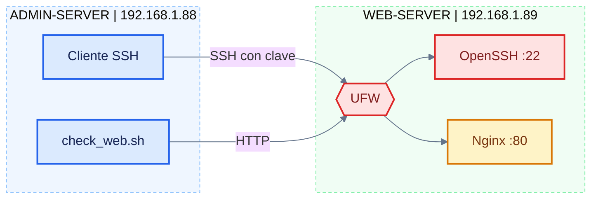

# Linux SysAdmin Web Infrastructure Runbook

Runbook operativo para construir y administrar una infraestructura web pequeña sobre Ubuntu Server: acceso remoto por clave SSH, publicación con Nginx, gestión de usuarios y permisos, firewall UFW, análisis de logs y recuperación de servicios.


---

## Descripción

Este repositorio documenta, paso a paso, un laboratorio de administración Linux con dos servidores. Un servidor de administración gestiona de forma remota un servidor web, y sobre ese servidor se aplican las tareas habituales de un administrador de sistemas: despliegue, control de acceso, seguridad de red, diagnóstico y recuperación ante incidentes.

El documento principal es [`runbook.md`](./runbook.md). Cada fase incluye su objetivo, diagrama, comandos explicados, resultado esperado y validación.

## Arquitectura



ADMIN-SERVER actúa como estación de administración y monitorización. WEB-SERVER ejecuta Nginx y filtra todo el tráfico entrante con UFW: SSH solo desde la IP del administrador y HTTP desde cualquier origen.

## Contenido del runbook

| Fase | Tema | Tiempo |
|---|---|---|
| 1 | Conectividad y SSH por clave | 3 min |
| 2 | Instalación y gestión de Nginx | 4 min |
| 3 | Publicación del sitio web | 3 min |
| 4 | Usuarios, grupos y permisos (SGID) | 4 min |
| 5 | Firewall con UFW | 4 min |
| 6 | Logs y diagnóstico | 4 min |
| 7 | Script de monitorización | 3 min |
| 8 | Incidente y recuperación | 4 min |

Además incluye cronograma, validación final, guía rápida de diagnóstico, buenas prácticas de seguridad y preguntas de comprobación.

## Requisitos

- Dos servidores Ubuntu Server con conectividad entre ellos.
- Usuario con permisos `sudo` en ambos equipos.
- OpenSSH Server activo en el servidor web.
- Acceso a Internet en el servidor web para instalar paquetes.

## Inicio rápido

1. Clonar el repositorio:

   ```bash
   git clone https://github.com/<usuario>/linux-sysadmin-web-infrastructure-runbook.git
   cd linux-sysadmin-web-infrastructure-runbook
   ```

2. Abrir [`runbook.md`](./runbook.md) y sustituir las IPs del laboratorio por las de tu red:

   | Valor de ejemplo | Rol |
   |---|---|
   | `192.168.1.88` | ADMIN-SERVER |
   | `192.168.1.89` | WEB-SERVER |
   | `gmt` | Usuario de trabajo |

3. Seguir las fases en orden, de la 1 a la 8. Cada bloque indica en qué servidor se ejecuta.

## Estructura del repositorio

```text
.
├── README.md      Presentación y guía de uso
├── runbook.md     Documento operativo completo
└── LICENSE        Licencia del proyecto
```

## Archivos que se crean durante el laboratorio

| Servidor | Ruta | Función |
|---|---|---|
| ADMIN | `~/.ssh/id_ed25519` | Clave privada del administrador |
| ADMIN | `~/scripts/check_web.sh` | Monitorización HTTP |
| WEB | `/etc/nginx/sites-available/labweb` | Definición del sitio |
| WEB | `/etc/nginx/sites-enabled/labweb` | Enlace que activa el sitio |
| WEB | `/var/www/labweb/index.html` | Página publicada |
| WEB | `/srv/webadmin` | Directorio de trabajo con SGID |
| WEB | `/etc/ssh/sshd_config.d/10-lab.conf` | Endurecimiento SSH (opcional) |

## Competencias que cubre

Administración remota segura, gestión de servicios con systemd, despliegue de Nginx, control de acceso con usuarios y permisos, configuración de firewall, análisis de logs, automatización con Bash y respuesta a incidentes.

## Advertencias

- Este laboratorio modifica reglas de firewall y configuración SSH. Mantener siempre una sesión abierta y probar una segunda conexión antes de cerrar la primera.
- Las direcciones IP y el usuario son del entorno original. Ajustarlos antes de ejecutar cualquier comando.
- El contenido está pensado para entornos de práctica. Antes de aplicarlo en producción, revisar cada paso según las políticas de seguridad de la organización.

## Contribuciones

Las mejoras son bienvenidas. Para proponer un cambio, abrir un issue describiendo el problema o la mejora, o enviar un pull request con una descripción clara de lo que modifica y por qué.

## Licencia

Distribuido bajo licencia MIT. Consultar el archivo `LICENSE` para más detalles.
