# Runbook: Administración Linux de una infraestructura web

### Administración remota, despliegue con Nginx, usuarios, permisos, firewall y recuperación de servicios


---

## Tabla de contenido

1. [Objetivo y alcance](#1-objetivo-y-alcance)
2. [Arquitectura](#2-arquitectura)
3. [Estructura de directorios y archivos](#3-estructura-de-directorios-y-archivos)
4. [Requisitos y preparación](#4-requisitos-y-preparación)
5. [Fase 1: Conectividad y SSH por clave](#fase-1-conectividad-y-ssh-por-clave)
6. [Fase 2: Instalación de Nginx](#fase-2-instalación-de-nginx)
7. [Fase 3: Publicación del sitio web](#fase-3-publicación-del-sitio-web)
8. [Fase 4: Usuarios, grupos y permisos](#fase-4-usuarios-grupos-y-permisos)
9. [Fase 5: Firewall con UFW](#fase-5-firewall-con-ufw)
10. [Fase 6: Logs y diagnóstico](#fase-6-logs-y-diagnóstico)
11. [Fase 7: Script de monitorización](#fase-7-script-de-monitorización)
12. [Fase 8: Incidente y recuperación](#fase-8-incidente-y-recuperación)
13. [Cronograma](#13-cronograma)
14. [Validación final](#14-validación-final)
15. [Guía rápida de diagnóstico](#15-guía-rápida-de-diagnóstico)
16. [Seguridad y buenas prácticas](#16-seguridad-y-buenas-prácticas)
17. [Preguntas de comprobación](#17-preguntas-de-comprobación)

---

## 1. Objetivo y alcance

Construir y operar una infraestructura web pequeña con dos servidores Ubuntu Server. Desde un servidor de administración se gestiona de forma remota un segundo servidor que publica un sitio con Nginx.

| Tarea | Herramienta |
|---|---|
| Comprobar conectividad | `ping` |
| Acceso remoto sin contraseña | `ssh-keygen`, `ssh-copy-id` |
| Gestión de servicios | `systemctl` |
| Publicación web | Nginx |
| Identidades y permisos | `adduser`, `groupadd`, `chown`, `chmod` |
| Protección de red | UFW |
| Diagnóstico | `journalctl`, `tail`, `ss`, `curl` |
| Automatización | Bash |

**Resultado final:** infraestructura web operativa, protegida por firewall, administrada remotamente y con un procedimiento básico de monitorización y recuperación.

---

## 2. Arquitectura

### 2.1. Inventario

| Elemento | ADMIN-SERVER | WEB-SERVER |
|---|---|---|
| Función | Estación de administración | Servidor web |
| Dirección IP | `192.168.1.88` | `192.168.1.89` |
| Usuario de trabajo | `gmt` | `gmt` |
| Sistema operativo | Ubuntu Server | Ubuntu Server 26.04.1 LTS |
| Servicios | Cliente SSH, Bash, curl | OpenSSH, Nginx, UFW |

> **Nota:** las direcciones corresponden al laboratorio original. En otra red, sustituirlas por las reales en todos los comandos, reglas de firewall y scripts.

### 2.2. Topología y flujo de tráfico

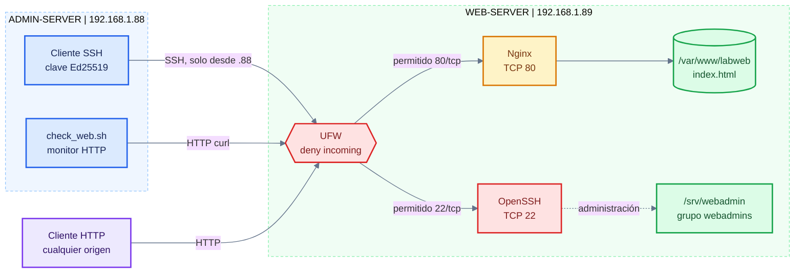

**Lectura del diagrama.** Todo el tráfico entrante a WEB-SERVER pasa primero por UFW, que actúa como punto único de control. El administrador entra por SSH (puerto 22), regla restringida a la IP `192.168.1.88`. Cualquier cliente puede consultar el sitio por HTTP (puerto 80). Nginx sirve el contenido desde `/var/www/labweb`. El directorio `/srv/webadmin` es un espacio de trabajo reservado al grupo `webadmins` y no se expone por HTTP. La línea punteada indica un acceso administrativo, no un flujo de usuarios finales.

### 2.3. Secuencia de administración

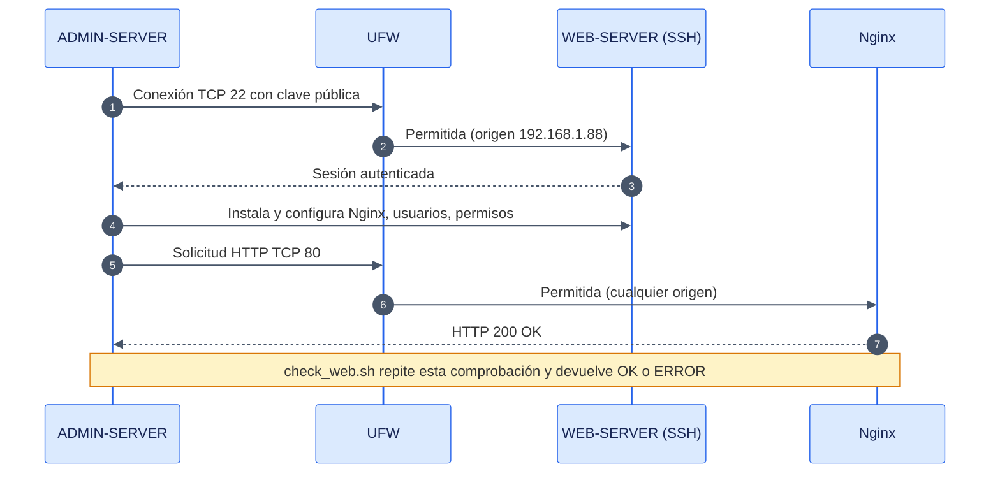

**Lectura del diagrama.** Muestra el orden real de eventos: primero se establece el canal administrativo cifrado, luego se despliega el servicio y finalmente se valida desde el exterior. El firewall aparece en ambos caminos porque filtra cada conexión antes de llegar al servicio.

---

## 3. Estructura de directorios y archivos

### 3.1. Mapa de rutas

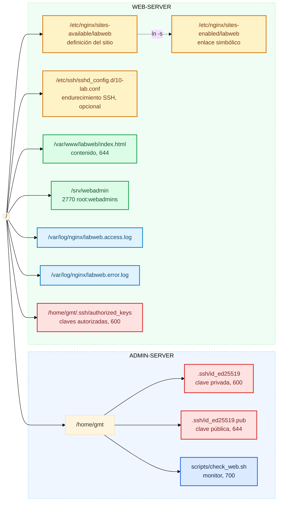

**Lectura del diagrama.** Los colores identifican el tipo de recurso: amarillo para configuración, verde para datos y contenido, rojo para material criptográfico sensible, azul claro para registros y azul para scripts. El enlace simbólico de `sites-enabled` apunta al archivo real de `sites-available`: así se activa o desactiva un sitio sin borrar su definición.

### 3.2. Archivos clave

| Servidor | Ruta | Tipo | Propietario | Permisos | Función |
|---|---|---|---|---|---|
| ADMIN | `~/.ssh/id_ed25519` | Clave privada | `gmt` | `600` | Identidad del administrador. Nunca se copia. |
| ADMIN | `~/.ssh/id_ed25519.pub` | Clave pública | `gmt` | `644` | Se instala en el servidor remoto. |
| ADMIN | `~/scripts/check_web.sh` | Script | `gmt` | `700` | Comprobación HTTP de WEB-SERVER. |
| WEB | `~/.ssh/authorized_keys` | Claves autorizadas | `gmt` | `600` | Claves públicas con acceso permitido. |
| WEB | `/etc/nginx/sites-available/labweb` | Configuración | `root` | `644` | Definición del sitio (puerto, raíz, logs). |
| WEB | `/etc/nginx/sites-enabled/labweb` | Enlace simbólico | `root` | `777` (enlace) | Activa el sitio. |
| WEB | `/var/www/labweb/index.html` | Contenido | `root` | `644` | Página publicada. |
| WEB | `/srv/webadmin` | Directorio | `root:webadmins` | `2770` | Espacio de trabajo del grupo. |
| WEB | `/etc/ssh/sshd_config.d/10-lab.conf` | Configuración | `root` | `644` | Endurecimiento SSH (opcional). |
| WEB | `/var/log/nginx/labweb.*.log` | Registros | `root:adm` | `640` | Accesos y errores del sitio. |

---

## 4. Requisitos y preparación

### 4.1. Requisitos técnicos

- Dos servidores Ubuntu Server con conectividad de red entre ellos.
- Usuario `gmt` con `sudo` en ambos.
- OpenSSH Server instalado y activo en WEB-SERVER.
- Acceso a Internet en WEB-SERVER para instalar paquetes.

### 4.2. Identificación de los servidores

Ejecutar en cada servidor:

```bash
hostname
hostname -I
whoami
```

| Servidor | IP esperada | Usuario |
|---|---|---|
| ADMIN-SERVER | `192.168.1.88` | `gmt` |
| WEB-SERVER | `192.168.1.89` | `gmt` |

### 4.3. Responsabilidad del instructor

Dejar listos de antemano: sistemas instalados, IPs configuradas, usuario `gmt` con `sudo` y OpenSSH operativo en WEB-SERVER. Nginx, sitio, usuarios, permisos y firewall forman parte del ejercicio. Si los estudiantes deben instalar el sistema operativo y la red, ampliar la sesión a 60-90 minutos.

### 4.4. Convención de este documento

Cada bloque indica en qué servidor se ejecuta con una etiqueta:

 

---

# Fase 1: Conectividad y SSH por clave

 

**Objetivo.** Verificar que ADMIN-SERVER alcanza a WEB-SERVER y establecer autenticación SSH por clave pública.

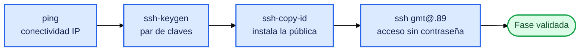

**Lectura del diagrama.** Cada paso depende del anterior: sin red no hay SSH, sin clave no hay autenticación por clave. Si un paso falla, no avanzar.

### Paso 1.1. Comprobar conectividad


```bash
ping -c 4 192.168.1.89
```

| Elemento | Función |
|---|---|
| `ping` | Envía solicitudes ICMP para comprobar alcance IP |
| `-c 4` | Limita el envío a cuatro paquetes |

Resultado esperado: `4 packets transmitted, 4 received, 0% packet loss`. Con pérdida de paquetes, revisar IP, cableado o red virtual antes de continuar.

### Paso 1.2. Generar la clave SSH


```bash
ssh-keygen -t ed25519 -C "gmt@admin-server"
```

Aceptar la ruta predeterminada. Se recomienda definir una frase de paso (passphrase) para proteger la clave privada si el equipo se compromete.

| Archivo generado | Contenido |
|---|---|
| `/home/gmt/.ssh/id_ed25519` | Clave privada. No se comparte. |
| `/home/gmt/.ssh/id_ed25519.pub` | Clave pública. Se instala en el servidor. |

`-t ed25519` selecciona un algoritmo moderno, compacto y rápido. `-C` agrega un comentario que identifica el origen de la clave.

### Paso 1.3. Instalar la clave pública


```bash
ssh-copy-id gmt@192.168.1.89
```

Pide la contraseña de `gmt` una sola vez y agrega la clave pública a `/home/gmt/.ssh/authorized_keys` en WEB-SERVER, creando el directorio con los permisos correctos si no existe.

### Paso 1.4. Probar el acceso


```bash
ssh gmt@192.168.1.89 "hostname; whoami"
```

Resultado esperado:

```text
web-server
gmt
```

### Validación

- `ping` sin pérdida.
- `ssh` conecta sin pedir contraseña de la cuenta.

---

# Fase 2: Instalación de Nginx

 

**Objetivo.** Instalar el servidor web y gestionar su ciclo de vida con systemd.

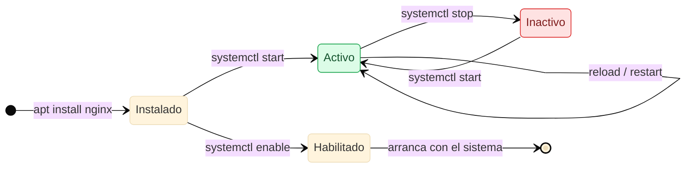

**Lectura del diagrama.** Distingue dos conceptos que suelen confundirse: el estado actual del servicio (activo o inactivo) y su comportamiento en el arranque (habilitado o no). `enable --now` resuelve ambos en un solo comando.

### Paso 2.1. Actualizar el índice de paquetes


```bash
ssh gmt@192.168.1.89
sudo apt update
```

`apt update` refresca la lista de paquetes disponibles; no actualiza programas ya instalados.

### Paso 2.2. Instalar Nginx

```bash
sudo apt install -y nginx
```

| Elemento | Función |
|---|---|
| `apt install` | Instala el paquete y sus dependencias |
| `-y` | Confirma automáticamente |

### Paso 2.3. Habilitar e iniciar

```bash
sudo systemctl enable --now nginx
sudo systemctl is-active nginx
```

`enable` crea el inicio automático; `--now` inicia el servicio de inmediato. Resultado esperado de `is-active`: `active`. Para el detalle completo: `sudo systemctl status nginx` (salir con `q`).

### Paso 2.4. Comprobar el puerto

```bash
sudo ss -tlnp | grep ':80'
```

| Opción | Función |
|---|---|
| `-t` | Solo TCP |
| `-l` | Solo sockets en escucha |
| `-n` | Puertos y direcciones numéricos |
| `-p` | Proceso propietario |

Resultado esperado: un proceso `nginx` escuchando en `0.0.0.0:80`.

### Paso 2.5. Probar desde el administrador


Salir de WEB-SERVER con `exit` y ejecutar:

```bash
curl -I http://192.168.1.89
```

Resultado esperado: `HTTP/1.1 200 OK`.

---

# Fase 3: Publicación del sitio web

 

**Objetivo.** Publicar una página propia mediante un sitio dedicado de Nginx, con raíz y logs independientes del sitio predeterminado.

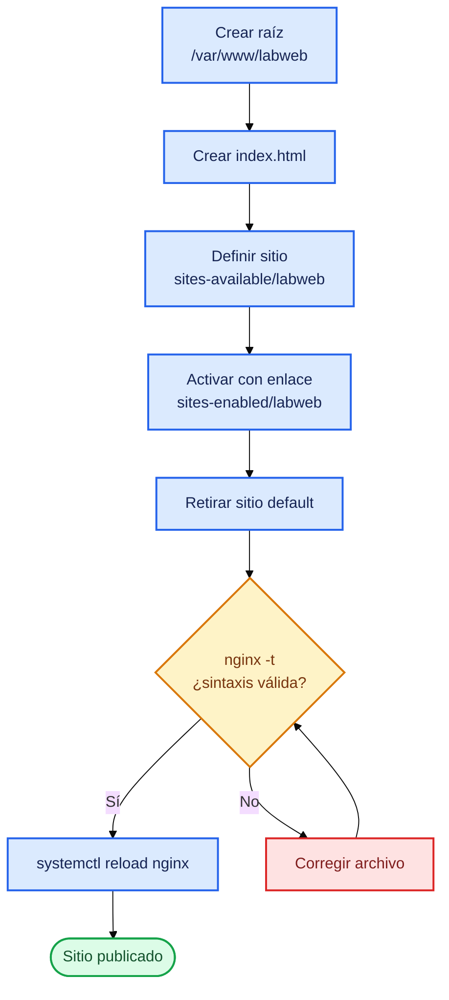

**Lectura del diagrama.** El punto crítico es la validación con `nginx -t` antes de recargar. Si la sintaxis falla, el servicio en ejecución no se toca y el sitio sigue funcionando con la configuración anterior.

### Paso 3.1. Crear la raíz del sitio


```bash
sudo install -d -m 755 -o root -g root /var/www/labweb
```

`install -d` crea el directorio con propietario y permisos definidos en un solo paso.

### Paso 3.2. Crear la página

**Archivo:** `/var/www/labweb/index.html`

```bash
sudo tee /var/www/labweb/index.html > /dev/null <<'EOF'
<!DOCTYPE html>
<html lang="es">
<head>
    <meta charset="UTF-8">
    <meta name="viewport" content="width=device-width, initial-scale=1">
    <title>Linux SysAdmin Lab</title>
</head>
<body>
    <h1>Servidor Linux funcionando</h1>
    <h2>Laboratorio de Administración Linux</h2>
    <hr>
    <p><strong>Servidor:</strong> WEB-SERVER</p>
    <p><strong>Dirección IP:</strong> 192.168.1.89</p>
    <p><strong>Sistema operativo:</strong> Ubuntu Server 26.04.1 LTS</p>
    <p><strong>Servicio:</strong> Nginx</p>
    <p><strong>Estado:</strong> Operativo</p>
    <hr>
    <p>Infraestructura administrada remotamente desde ADMIN-SERVER.</p>
</body>
</html>
EOF
sudo chmod 644 /var/www/labweb/index.html
```

`tee` con redirección a `/dev/null` permite escribir un archivo protegido usando `sudo`, algo que `>` directo no logra. El delimitador `'EOF'` entre comillas evita que el shell interprete el contenido.

### Paso 3.3. Definir el sitio

**Archivo:** `/etc/nginx/sites-available/labweb`

```bash
sudo tee /etc/nginx/sites-available/labweb > /dev/null <<'EOF'
server {
    listen 80 default_server;
    listen [::]:80 default_server;
    server_name _;

    root /var/www/labweb;
    index index.html;

    access_log /var/log/nginx/labweb.access.log;
    error_log  /var/log/nginx/labweb.error.log;

    location / {
        try_files $uri $uri/ =404;
    }
}
EOF
```

| Directiva | Función |
|---|---|
| `listen 80 default_server` | Escucha en IPv4 puerto 80 y atiende solicitudes sin coincidencia de nombre |
| `listen [::]:80` | Equivalente para IPv6 |
| `server_name _` | Nombre comodín; este sitio responde para cualquier host |
| `root` | Directorio desde el que se sirven los archivos |
| `index` | Archivo que se entrega al pedir un directorio |
| `access_log` / `error_log` | Registros propios del sitio |
| `try_files $uri $uri/ =404` | Busca archivo, luego directorio; si no existe, responde 404 |

### Paso 3.4. Activar el sitio y retirar el predeterminado

```bash
sudo ln -s /etc/nginx/sites-available/labweb /etc/nginx/sites-enabled/labweb
sudo rm -f /etc/nginx/sites-enabled/default
```

Se retira el enlace del sitio `default` porque también declara `default_server` en el puerto 80 y provocaría un conflicto. El archivo original en `sites-available` se conserva.

### Paso 3.5. Validar y recargar

```bash
sudo nginx -t
sudo systemctl reload nginx
```

Resultado esperado de `nginx -t`: `syntax is ok` y `test is successful`.

### Paso 3.6. Verificar contenido

```bash
curl -sS http://localhost | head -n 5
```


Tras `exit`, desde el administrador:

```bash
curl -sS http://192.168.1.89 | grep "<h1>"
```

Resultado esperado: `<h1>Servidor Linux funcionando</h1>`.

---

# Fase 4: Usuarios, grupos y permisos

 

**Objetivo.** Crear un operador web y un directorio de trabajo compartido aplicando mínimo privilegio.

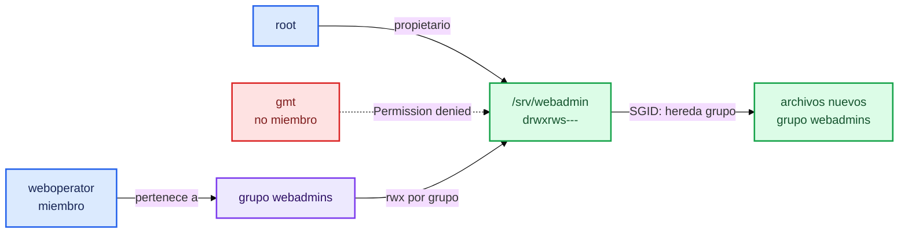

**Lectura del diagrama.** Solo root y los miembros de `webadmins` entran al directorio. `gmt` queda fuera a propósito para demostrar la separación de permisos. El bit SGID hace que todo lo creado dentro herede el grupo, sin depender de que cada usuario lo configure.

### Paso 4.1. Crear el grupo


```bash
getent group webadmins || sudo groupadd webadmins
```

`getent` consulta si existe; `||` ejecuta `groupadd` solo si la consulta falla. Así el comando es repetible sin errores.

### Paso 4.2. Crear el usuario y asignarlo

```bash
sudo adduser weboperator
sudo usermod -aG webadmins weboperator
```

| Opción de `usermod` | Función |
|---|---|
| `-G` | Define grupos suplementarios |
| `-a` | Agrega sin eliminar los grupos actuales. Omitirlo reemplaza la lista completa. |

### Paso 4.3. Validar identidad

```bash
id weboperator
getent group webadmins
```

Resultado esperado: `webadmins:x:<GID>:weboperator`. El GID puede variar.

### Paso 4.4. Crear el directorio administrativo

```bash
sudo mkdir -p /srv/webadmin
sudo chown root:webadmins /srv/webadmin
sudo chmod 2770 /srv/webadmin
ls -ld /srv/webadmin
```

Resultado esperado: `drwxrws--- ... root webadmins ... /srv/webadmin`.

| Dígito de `2770` | Significado |
|---|---|
| `2` | SGID: los elementos nuevos heredan el grupo del directorio |
| `7` | Propietario: lectura, escritura y ejecución |
| `7` | Grupo: lectura, escritura y ejecución |
| `0` | Otros: sin acceso |

### Paso 4.5. Probar el acceso del operador

```bash
sudo -u weboperator touch /srv/webadmin/prueba.txt
sudo ls -l /srv/webadmin
```

Resultado esperado: `-rw-r--r-- 1 weboperator webadmins ... prueba.txt`.

> **Atención con umask.** SGID transfiere el grupo, pero no concede escritura grupal sobre archivos nuevos. El `644` observado depende de la `umask` del usuario. Para que el grupo pueda editar archivos de otros miembros, aplicar una ACL predeterminada:
>
> ```bash
> sudo apt install -y acl
> sudo setfacl -d -m g:webadmins:rwx /srv/webadmin
> ```

### Paso 4.6. Comprobar la separación

```bash
id gmt
ls -l /srv/webadmin
sudo ls -l /srv/webadmin
```

El segundo comando debe devolver `Permission denied` si `gmt` no pertenece a `webadmins`. El tercero funciona porque usa privilegios de administrador.

---

# Fase 5: Firewall con UFW

 

**Objetivo.** Permitir solo el tráfico necesario: SSH desde el administrador y HTTP desde cualquier origen.

> **Advertencia operativa.** Una regla SSH con IP equivocada deja el servidor inaccesible por red. Mantener abierta la sesión actual y comprobar una segunda conexión antes de cerrar la primera.

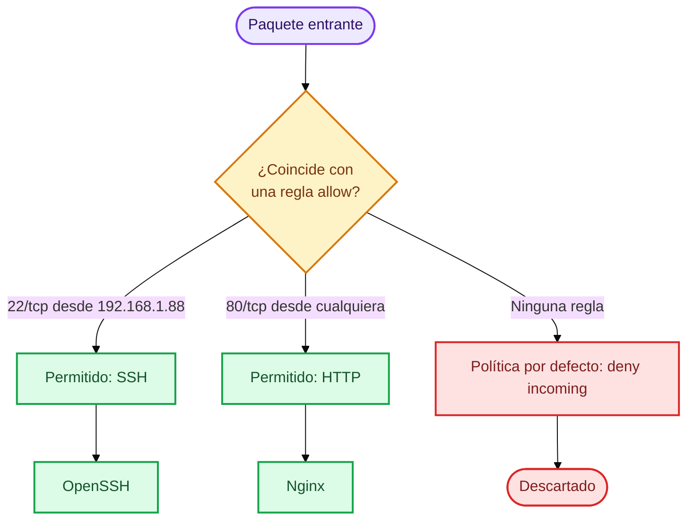

**Lectura del diagrama.** UFW evalúa cada paquete contra las reglas permitidas. Lo que no coincide cae en la política por defecto y se descarta. Es un modelo de lista blanca: todo está prohibido salvo lo declarado.

### Paso 5.1. Estado inicial


```bash
sudo ufw status verbose
```

Estado inicial habitual: `Status: inactive`.

### Paso 5.2. Políticas por defecto

```bash
sudo ufw default deny incoming
sudo ufw default allow outgoing
```

Bloquea todo lo entrante no autorizado y permite todo lo saliente (necesario para `apt`, DNS y actualizaciones).

### Paso 5.3. Reglas de acceso

```bash
sudo ufw allow from 192.168.1.88 to any port 22 proto tcp
sudo ufw allow 80/tcp
```

| Regla | Efecto |
|---|---|
| `from 192.168.1.88 to any port 22 proto tcp` | SSH solo desde ADMIN-SERVER |
| `80/tcp` | HTTP desde cualquier origen, IPv4 e IPv6 |

### Paso 5.4. Revisar antes de activar

```bash
sudo ufw show added
```

Deben aparecer exactamente las dos reglas anteriores.

### Paso 5.5. Activar

```bash
sudo ufw enable
```

Confirmar con `y`. El firewall queda habilitado también en el arranque.

### Paso 5.6. Verificar

```bash
sudo ufw status verbose
```

```text
Status: active
Default: deny (incoming), allow (outgoing)

22/tcp    ALLOW IN    192.168.1.88
80/tcp    ALLOW IN    Anywhere
80/tcp (v6) ALLOW IN  Anywhere (v6)
```

El formato exacto puede variar según la versión.

### Paso 5.7. Validar desde ADMIN-SERVER


Abrir una segunda terminal, sin cerrar la sesión SSH existente:

```bash
ssh gmt@192.168.1.89 "hostname"
curl -I http://192.168.1.89
```

Resultado esperado: el nombre del host y `HTTP/1.1 200 OK`. Solo entonces cerrar la sesión anterior.

### Paso 5.8. Opcional: endurecer SSH

Una vez confirmado el acceso por clave, se puede desactivar la autenticación por contraseña.


**Archivo:** `/etc/ssh/sshd_config.d/10-lab.conf`

```bash
sudo tee /etc/ssh/sshd_config.d/10-lab.conf > /dev/null <<'EOF'
PasswordAuthentication no
PermitRootLogin no
EOF
sudo sshd -t && sudo systemctl reload ssh
```

| Directiva | Efecto |
|---|---|
| `PasswordAuthentication no` | Solo se acepta autenticación por clave |
| `PermitRootLogin no` | Prohíbe el acceso directo como root |

`sshd -t` valida la sintaxis; el `&&` evita recargar si hay un error. Probar siempre una nueva sesión antes de cerrar la actual. En algunas versiones de Ubuntu, otros archivos de `sshd_config.d` con nombre anterior en orden alfabético pueden prevalecer: revisar con `sudo sshd -T | grep -i passwordauth`.

---

# Fase 6: Logs y diagnóstico

 

**Objetivo.** Distinguir las fuentes de registro y usarlas para interpretar el comportamiento del servicio.

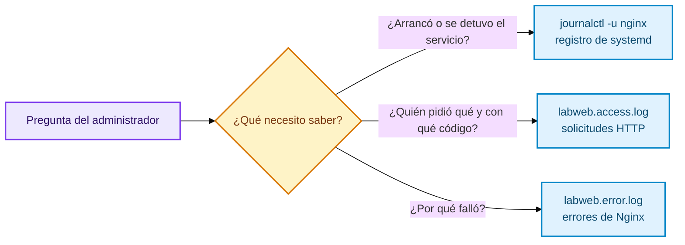

**Lectura del diagrama.** Cada pregunta tiene su fuente. systemd informa sobre el ciclo de vida del servicio; los archivos de Nginx informan sobre el tráfico y los errores de la aplicación.

### Paso 6.1. Registro de systemd


```bash
sudo journalctl -u nginx -n 20 --no-pager
```

| Opción | Función |
|---|---|
| `-u nginx` | Filtra por la unidad Nginx |
| `-n 20` | Últimas 20 entradas |
| `--no-pager` | Salida directa, sin paginador interactivo |

### Paso 6.2. Accesos y errores

```bash
sudo tail -n 10 /var/log/nginx/labweb.access.log
sudo tail -n 10 /var/log/nginx/labweb.error.log
```

El registro de accesos incluye IP del cliente, fecha, método, ruta y código de respuesta. En el de errores, los mensajes `notice` son informativos y no indican falla.

### Paso 6.3. Generar un 404 controlado

```bash
curl -I http://localhost/pagina-inexistente
sudo tail -n 3 /var/log/nginx/labweb.access.log
```

Resultado esperado: `HTTP/1.1 404 Not Found` y una línea con `/pagina-inexistente` y código `404`.

**Interpretación.** Un 404 prueba que Nginx está activo y respondió; solo indica que el recurso no existe. No debe confundirse con un servicio caído.

---

# Fase 7: Script de monitorización

 

**Objetivo.** Automatizar la comprobación HTTP desde ADMIN-SERVER, con código de salida utilizable por otras herramientas.

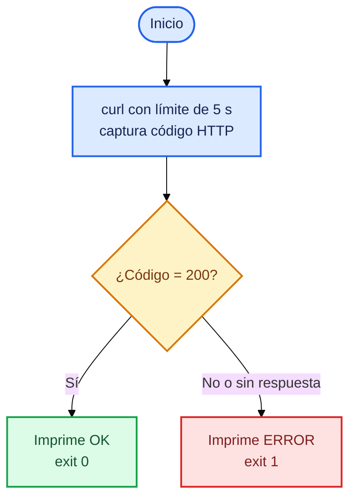

**Lectura del diagrama.** El script valida el código HTTP exacto y devuelve un estado de salida: `0` para correcto y `1` para error. Esto permite integrarlo en cron, pipelines o sistemas de alerta.

### Paso 7.1. Crear el script


**Archivo:** `/home/gmt/scripts/check_web.sh`

```bash
mkdir -p ~/scripts
tee ~/scripts/check_web.sh > /dev/null <<'EOF'
#!/usr/bin/env bash
set -u

SERVER="192.168.1.89"
URL="http://${SERVER}"

echo "================================"
echo "   LINUX SERVER HEALTH CHECK"
echo "================================"
echo "Servidor: ${SERVER}"
echo "Fecha: $(date)"
echo

CODE=$(curl -s -o /dev/null -w '%{http_code}' --max-time 5 "$URL")

if [ "$CODE" = "200" ]; then
    echo "[OK] Servidor WEB operativo (HTTP ${CODE})"
    STATUS=0
else
    echo "[ERROR] Servidor WEB no responde (HTTP ${CODE})"
    STATUS=1
fi

echo
echo "================================"
exit "$STATUS"
EOF
chmod 700 ~/scripts/check_web.sh
```

| Elemento | Función |
|---|---|
| `#!/usr/bin/env bash` | Selecciona Bash como intérprete |
| `set -u` | Falla si se usa una variable no definida |
| `-s` | Modo silencioso |
| `-o /dev/null` | Descarta el cuerpo de la respuesta |
| `-w '%{http_code}'` | Imprime solo el código HTTP |
| `--max-time 5` | Aborta tras cinco segundos |
| `exit "$STATUS"` | Devuelve 0 o 1 al llamador |

Cuando no hay conexión, `curl` devuelve `000` como código.

### Paso 7.2. Ejecutar

```bash
~/scripts/check_web.sh; echo "Código de salida: $?"
```

Resultado esperado:

```text
================================
   LINUX SERVER HEALTH CHECK
================================
Servidor: 192.168.1.89
Fecha: ...

[OK] Servidor WEB operativo (HTTP 200)

================================
Código de salida: 0
```

---

# Fase 8: Incidente y recuperación

 

**Objetivo.** Provocar una caída controlada de Nginx, detectarla desde el administrador y restaurar el servicio.

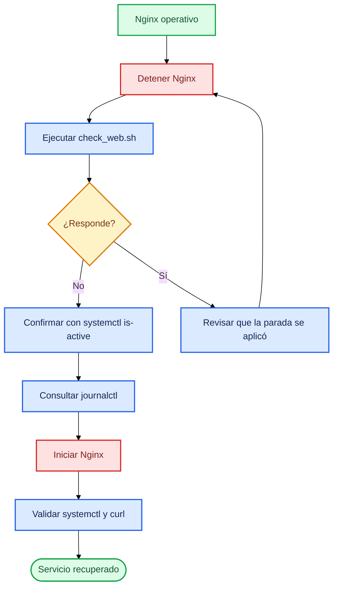

**Lectura del diagrama.** Refleja el método de trabajo: detectar, confirmar, diagnosticar, actuar y validar. La recuperación no termina al ejecutar `start`; termina cuando se verifica desde el punto de vista del usuario.

### Paso 8.1. Provocar la caída


```bash
sudo systemctl stop nginx
sudo systemctl is-active nginx
```

Resultado esperado: `inactive`.

### Paso 8.2. Detectar desde ADMIN-SERVER


```bash
curl -I --max-time 5 http://192.168.1.89
~/scripts/check_web.sh
```

El primer comando falla con `Connection refused`. El script debe mostrar `[ERROR] Servidor WEB no responde (HTTP 000)`. La sesión SSH sigue viva porque solo se detuvo Nginx, no el sistema operativo ni OpenSSH.

### Paso 8.3. Recuperar


```bash
sudo systemctl start nginx
sudo systemctl is-active nginx
```

Resultado esperado: `active`.

### Paso 8.4. Validar


```bash
curl -I http://192.168.1.89
~/scripts/check_web.sh
```

Resultado esperado: `HTTP/1.1 200 OK` y `[OK] Servidor WEB operativo (HTTP 200)`.

### Paso 8.5. Revisar el historial


```bash
sudo journalctl -u nginx -n 20 --no-pager
```

Se observan los eventos de detención e inicio con su marca de tiempo.

---

## 13. Cronograma

```mermaid
%%{init: {'theme':'base','themeVariables':{'fontFamily':'Inter, Segoe UI, sans-serif'}}}%%
gantt
    title Plan de ejecución de 30 minutos
    dateFormat  HH:mm
    axisFormat  %H:%M
    section Acceso
    Fase 1 Conectividad y SSH        :done, f1, 00:00, 3m
    section Servicio
    Fase 2 Instalación de Nginx      :f2, after f1, 4m
    Fase 3 Publicación del sitio     :f3, after f2, 3m
    section Seguridad
    Fase 4 Usuarios y permisos       :crit, f4, after f3, 4m
    Fase 5 Firewall UFW              :crit, f5, after f4, 4m
    section Operación
    Fase 6 Logs y diagnóstico        :f6, after f5, 4m
    Fase 7 Script de monitorización  :f7, after f6, 3m
    Fase 8 Incidente y recuperación  :active, f8, after f7, 4m
    Cierre y validación              :milestone, after f8, 1m
```

**Lectura del diagrama.** Las fases marcadas en rojo (`crit`) son las de mayor impacto en seguridad y requieren más atención. El plan supone máquinas preparadas; la primera ejecución individual suele tomar más tiempo.

| Tiempo | Fase |
|---|---|
| 00-03 | 1. Conectividad y SSH |
| 03-07 | 2. Nginx |
| 07-10 | 3. Sitio web |
| 10-14 | 4. Usuarios y permisos |
| 14-18 | 5. UFW |
| 18-22 | 6. Logs |
| 22-25 | 7. Script |
| 25-29 | 8. Incidente |
| 29-30 | Cierre |

---

## 14. Validación final

### Desde ADMIN-SERVER

```bash
ssh gmt@192.168.1.89 "hostname"
curl -I http://192.168.1.89
~/scripts/check_web.sh
```

### Desde WEB-SERVER

```bash
sudo systemctl is-active nginx
sudo nginx -t
sudo ufw status verbose
id weboperator
ls -ld /srv/webadmin
sudo ss -tlnp | grep ':80'
```

### Estado esperado

| Componente | Estado |
|---|---|
| Conectividad ADMIN a WEB | Operativa |
| SSH por clave | Operativo |
| Nginx | `active` |
| HTTP 80 | Accesible |
| Sitio `labweb` | Publicado y activo |
| Usuario `weboperator` y grupo `webadmins` | Creados |
| `/srv/webadmin` | `drwxrws---` con SGID |
| UFW | `active`, SSH solo desde `192.168.1.88` |
| Logs | Consultables |
| Script de monitorización | Devuelve OK, código 0 |

---

## 15. Guía rápida de diagnóstico

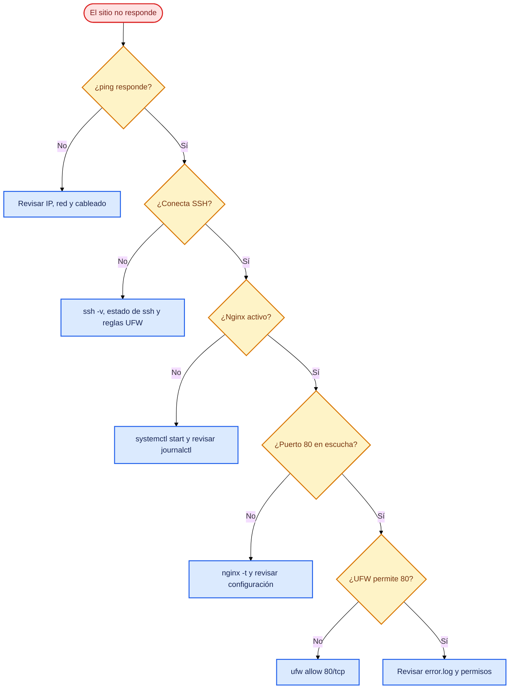

**Lectura del diagrama.** Avanza de la capa más baja a la más alta: red, acceso, servicio, puerto, firewall y aplicación. Resolver cada capa antes de pasar a la siguiente evita diagnósticos erróneos.

| Problema | Comando | Qué revisar |
|---|---|---|
| Sin conectividad | `ping -c 4 192.168.1.89` | IP y red |
| SSH no conecta | `ssh -v gmt@192.168.1.89` | Claves, usuario, red |
| SSH rechazado | `sudo systemctl status ssh` | Servicio OpenSSH |
| Nginx detenido | `sudo systemctl status nginx` | Estado del servicio |
| Puerto 80 cerrado | `sudo ss -tlnp \| grep ':80'` | Proceso en escucha |
| HTTP no responde | `curl -I http://192.168.1.89` | Nginx y UFW |
| Error 403 | `sudo tail -n 20 /var/log/nginx/labweb.error.log` | Permisos de `/var/www/labweb` |
| Error 404 | `sudo tail -n 20 /var/log/nginx/labweb.access.log` | Ruta solicitada |
| Error 5xx | `sudo journalctl -u nginx -n 30 --no-pager` | Servicio y registros |
| Configuración inválida | `sudo nginx -t` | Sintaxis |
| Firewall bloquea | `sudo ufw status verbose` | Reglas y origen |

### Comandos de recuperación habituales

```bash
sudo systemctl restart nginx      # reinicio completo, corta conexiones activas
sudo systemctl start nginx        # iniciar
sudo systemctl stop nginx         # detener
sudo nginx -t && sudo systemctl reload nginx   # recarga segura sin cortes
sudo systemctl status nginx       # estado
```

`reload` aplica la configuración sin interrumpir conexiones abiertas; usarlo solo después de que `nginx -t` pase.

---

## 16. Seguridad y buenas prácticas

1. No compartir claves privadas SSH y protegerlas con frase de paso.
2. Restringir SSH a la IP administrativa siempre que sea posible.
3. Verificar las reglas SSH antes de activar UFW.
4. Mantener una sesión abierta hasta validar una segunda conexión.
5. No usar permisos `777` como solución a problemas de acceso.
6. No trabajar con la cuenta root; usar `sudo` para cada acción.
7. Aplicar el principio de mínimo privilegio en usuarios y permisos.
8. Revisar los logs antes de modificar configuración.
9. Validar con `nginx -t` y `sshd -t` antes de recargar servicios.
10. No dejar servicios detenidos después de una simulación de incidente.

---

## 17. Preguntas de comprobación

| N.º | Pregunta | Respuesta esperada |
|---|---|---|
| 1 | Diferencia entre `systemctl start` y `enable` | `start` inicia ahora; `enable` configura el inicio en el arranque |
| 2 | Por qué usar claves SSH | Autenticación con par de claves; evita enviar contraseñas en cada conexión |
| 3 | Diferencia entre `chown` y `chmod` | `chown` cambia propietario y grupo; `chmod` cambia permisos |
| 4 | Qué hace el `2` en `chmod 2770` | Activa SGID: lo creado hereda el grupo del directorio |
| 5 | Por qué SSH solo desde ADMIN-SERVER | Reduce la superficie de exposición administrativa |
| 6 | Diferencia entre 404 y Nginx detenido | El 404 es una respuesta del servidor; con Nginx detenido no hay respuesta |
| 7 | Efecto de `systemctl stop nginx` | Detiene Nginx; el sistema y SSH siguen activos |
| 8 | Función de `journalctl` | Consultar los registros de systemd y sus servicios |
| 9 | Por qué `nginx -t` antes de `reload` | Evita aplicar una configuración inválida |

---

## Resultado esperado

Al completar el laboratorio, WEB-SERVER debe permanecer operativo, con Nginx activo y UFW habilitado, y el script `~/scripts/check_web.sh` debe devolver:

```text
[OK] Servidor WEB operativo (HTTP 200)
```


**Fin del runbook.**
